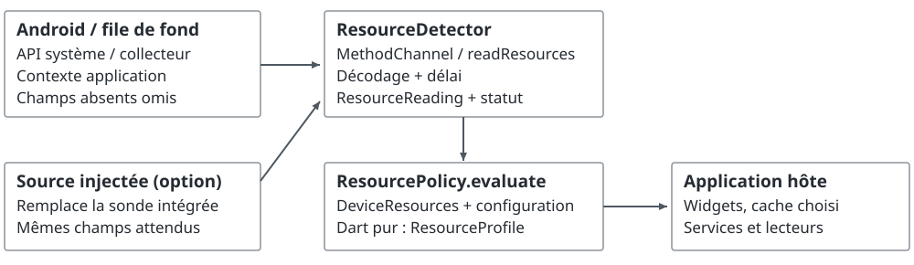
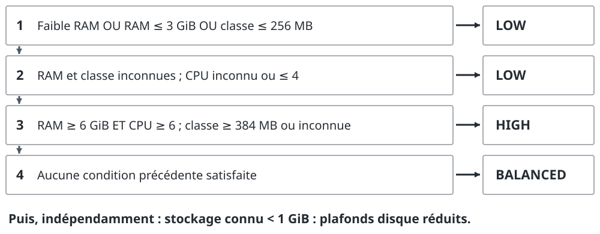
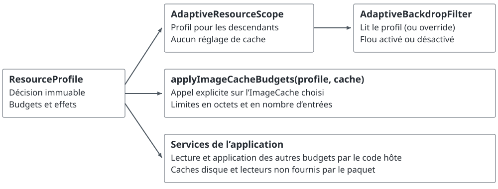

# Qwiper Adaptive

## Politique de ressources explicite pour Flutter

**Issoufa ABDOU OUSMANE**

**Abdoul Matinou MAMANE AMADOU**

**Abdoul Kader BACHIR OUSSEINI**

Note d'architecture et de validation · Version 0.1.0 · 15 octobre 2026

### Résumé

Une application Flutter peut s'exécuter sur des appareils dont la mémoire et le stockage disponibles diffèrent fortement. Qwiper Adaptive sépare trois responsabilités : acquérir un instantané partiel, calculer une politique déterministe, puis laisser l'application appliquer ses décisions. Une sonde Android relève cinq signaux ; un moteur Dart produit un niveau de ressources, des budgets configurables et une raison de classification. Un adaptateur Flutter peut désactiver le flou d'arrière-plan sans réinitialiser l'état de ses descendants. Les données absentes restent inconnues et les limites de cache ne sont jamais présentées comme des réservations de mémoire.

Cette note spécifie les contrats de la version 0.1.0, explique les choix de conception et distingue les tests exécutés des évaluations encore nécessaires. Les tests Dart, navigateur et AOT vérifient des comportements ; la compilation Android et les 12 tests Kotlin passent en CI. L'intégration sur appareil reste à valider. Aucun gain de performance n'est établi par cette implémentation.

### 1. Problème et périmètre

Un cache plus petit peut réduire les images conservées tout en augmentant les rechargements. Préparer moins de lecteurs peut économiser des ressources mais retarder le démarrage d'une vidéo. La bibliothèque expose ces arbitrages sous forme de paramètres ; elle ne cherche pas à déduire un score universel de performance à partir de quelques caractéristiques matérielles.

Les seuils initiaux proviennent des choix d'intégration de Qwiper. Ils constituent une configuration de départ, sans calibration comparative présentée ici. Leur modification ne demande ni service Qwiper, ni compte, ni backend. Les valeurs sont détaillées dans les sections 4 et 5 pour rendre la décision inspectable.

La version étudiée comprend un moteur de politique, une sonde Android, un scope Flutter, un filtre adaptatif et une fonction d'application au cache d'images. Elle ne fournit ni cache HTTP, ni lecteur vidéo, ni gestionnaire de pièces jointes, ni nettoyage automatique du stockage. Les budgets correspondants doivent être appliqués par les services de l'application.

### Compatibilité et reproductibilité

Le paquet déclare Flutter 3.44.0 et Dart 3.12.0 comme versions minimales. La sonde intégrée cible Android API 24 et suivantes. Sur Web, iOS et desktop, elle renvoie `unsupported` ; l'application peut fournir un lecteur personnalisé. Cette portabilité du code Dart ne vaut pas validation de tous les systèmes d'exploitation. Le [bilan de validation](../VALIDATION.md) décrit l'environnement et les commandes effectivement exécutées.

<!-- page -->

# 2. Modèle de données et architecture

`DeviceResources` est un objet immuable. Ses champs numériques sont de type `int?` et son indicateur de faible RAM de type `bool?`. La valeur `null` désigne une observation inconnue, jamais une estimation implicite de l'appareil.

| Champ et unité | Source Android | Interprétation et limite |
| --- | --- | --- |
| `logicalProcessors` : nombre | `Runtime` : `availableProcessors()` | Processeurs disponibles pour la machine virtuelle ; pas leur vitesse ni une mesure GPU. |
| `isLowRamDevice` : booléen | `ActivityManager` : `isLowRamDevice()` | Classification de faible RAM ; pas la pression mémoire actuelle. |
| `memoryClassMb` : MB de l'API | `ActivityManager` : `getMemoryClass()` | Classe mémoire normale approximative de l'application ; distincte du tas Dart et du RSS (mémoire résidente du processus). |
| `totalMemoryBytes` : octets | `MemoryInfo.totalMem` | RAM accessible au noyau, sans certaines réservations matérielles ; pas la RAM libre. |
| `availableStorageBytes` : octets | `StatFs(filesDir)` : `availableBytes` | Espace disponible sur le volume des fichiers de l'application ; pas une réservation. |

Les seuils comparent ces observations, et non la capacité commerciale de l'appareil. Une valeur annoncée en Go décimaux diffère également d'une valeur en GiB. **1 MiB = 1 048 576 octets ; 1 GiB = 1 073 741 824 octets.** La classe mémoire conserve l'unité MB et les valeurs de l'API Android. [1-4]



### Invariants de représentation

Les nombres connus doivent être finis et strictement positifs, sauf le stockage qui accepte zéro. `false` reste un booléen observé ; il ne suffit pas à classer un appareil comme performant. Les factories rejettent les valeurs invalides par `ArgumentError`, y compris sans assertions. Le profil conserve les observations d'origine : la politique ne remplit pas les champs manquants.

<!-- page -->

# 3. Collecte et contrat d'erreur

`ResourceDetector.read()` effectue une lecture ponctuelle. Sur Android, le canal `com.qwiper.adaptive/resources` appelle la méthode `readResources`. Le collecteur utilise le contexte application et la file de tâches de fond fournie par le moteur Flutter. Chaque mesure est isolée : une exception sur un champ n'efface pas les autres résultats. Aucune Activity, permission supplémentaire, télémétrie ou persistance n'est requise par la sonde fournie. [9]

Les mesures sont successives : l'instantané n'est **pas atomique**, et le stockage peut changer immédiatement après la lecture. Le plugin ne lance aucun timer. Au détachement, il retire son gestionnaire de canal et sa référence au collecteur ; une lecture déjà engagée peut néanmoins se terminer.

### Du payload à `ResourceReading`

Le décodeur accepte une map avec les cinq noms de champs de la section 2. Un champ absent ou nul devient inconnu. Les chaînes et nombres fractionnaires ne sont pas convertis ; les valeurs non finies et hors plage sont rejetées. Les champs supplémentaires sont ignorés. Si un champ est invalide, les autres champs valides sont conservés.

| Statut | Condition |
| --- | --- |
| `available` | Les cinq observations sont présentes et valides. |
| `partial` | Au moins une observation valide, aucune invalide, d'autres inconnues. |
| `invalidData` | Payload non conforme ou au moins un champ connu invalide ; les observations valides sont conservées. |
| `unavailable` | Aucune observation, plugin manquant ou `PlatformException`. |
| `unsupported` | Pas de sonde intégrée sur la plateforme, sans lecteur injecté. |
| `timedOut` | Le délai de la lecture a expiré, par défaut après deux secondes. |

`invalidData` a priorité sur `partial` lorsqu'une réponse mélange des champs valides et invalides. Une map vide et un résultat nul donnent `unavailable`. Le statut décrit la lecture, pas le niveau de ressources : même une lecture partielle peut conduire à `high` si les conditions de la section 4 sont remplies.

### Délai et lecteur personnalisé

L'expiration termine l'attente Dart, sans annuler l'opération native sous-jacente. Des lectures répétées peuvent donc encore produire du travail natif ; l'intégrateur choisit leur fréquence. Un lecteur injecté prend priorité sur la détection de plateforme. Ses exceptions inattendues remontent au code appelant afin de ne pas masquer une erreur de programmation. Le lecteur personnalisé reste responsable de ses propres effets de bord ; les propriétés d'absence de réseau et de persistance concernent le code fourni.

<!-- page -->

# 4. Algorithme de décision

`ResourcePolicy.evaluate(resources)` est une fonction déterministe de l'instantané et de sa configuration. `reason` identifie la première règle satisfaite. La figure présente les seuils par défaut ; le pseudocode précise leur ordre, y compris lorsque plusieurs observations signalent une contrainte.



### Algorithme 1 : priorité des décisions

Dans ce pseudocode, R désigne la RAM déclarée, H la classe mémoire, C les processeurs, et ? une observation inconnue. Les suffixes min/max correspondent aux seuils configurables de `ResourceThresholds`.

```text
si faibleRAM == vrai                 : low / lowRamDevice
sinon si R connu et R <= R_low_max   : low / lowTotalMemory
sinon si H connu et H <= H_low_max   : low / lowMemoryClass
sinon si R == ? et H == ? et C == ? : low / unknownResources
sinon si R == ? et H == ?
         et C <= C_fallback_max      : low / lowProcessorFallback
sinon si R connu et C connu
         et R >= R_high_min et C >= C_high_min
         et (H == ? ou H >= H_high_min) : high / highCapacity
sinon                               : balanced / balancedCapacity
```

La réduction des effets vaut `tier == low`. Le stockage est traité ensuite et ne change ni le niveau, ni la raison, ni la réduction des effets. Les seuils hauts de mémoire doivent dépasser les seuils bas correspondants. Les deux seuils CPU sont indépendants : le repli ne s'applique qu'en l'absence des deux observations mémoire.

### Cas instructifs

Toutes les capacités inconnues donnent `low`. Huit processeurs seuls donnent `balanced`, faute d'indice mémoire permettant `high`. Six GiB déclarés et six processeurs donnent `high` même si la classe mémoire est inconnue. À l'inverse, huit GiB et huit processeurs avec une classe de 256 MB donnent `low`. L'inconnu ne force donc pas systématiquement le même niveau.

<!-- page -->

# 5. Budgets et portée des décisions

Le niveau sélectionne un `ResourceBudgets`. Ces valeurs sont des recommandations indépendantes : le paquet ne réserve aucune ressource et ne calcule pas un budget global mémoire ou disque. L'application peut remplacer les budgets de chaque niveau, sans obligation de croissance entre les niveaux.

| Budget par défaut | Low | Balanced | High |
| --- | ---: | ---: | ---: |
| Images conservées en cache | 20 MiB | 36 MiB | 48 MiB |
| Entrées du cache d'images | 60 | 90 | 120 |
| Contrôleurs vidéo préparés | 2 | 4 | 5 |
| Cache HTTP sur disque | 20 MiB | 50 MiB | 80 MiB |
| Cache vidéo sur disque | 60 MiB | 120 MiB | 180 MiB |
| Cache de pièces jointes de discussion | 60 MiB | 100 MiB | 160 MiB |
| Cache de fichiers | 24 MiB | 40 MiB | 60 MiB |

### Contrainte de stockage indépendante

Par défaut, un espace connu strictement inférieur à 1 GiB active des plafonds : HTTP 10 MiB, vidéo 30 MiB, pièces jointes 30 MiB et fichiers 15 MiB. À exactement 1 GiB, la contrainte n'est pas active. L'espace inconnu n'active pas la contrainte ; un seuil configuré à zéro la désactive pour toutes les observations valides.

```text
stockageContraint = S connu et S < seuilStockage
pour chaque budget disque i :
  final[i] = min(budgetDuNiveau[i], plafond[i]) si contraint
  final[i] = budgetDuNiveau[i]                 sinon
```

Les limites disque sont finies et non négatives. Par construction, une contrainte ne peut pas augmenter un budget personnalisé déjà plus petit. Les limites d'images et de contrôleurs vidéo restent inchangées. Le paquet ne surveille ni l’occupation cumulée des caches, ni les écritures concurrentes, ni les autres fichiers du volume : l'application doit gérer les échecs de stockage.

### Mémoire et ressources réellement retenues

`applyImageCacheBudgets(profile, cache)` règle `maximumSizeBytes` et `maximumSize` sur le cache explicitement fourni. Réduire ces limites peut évincer des entrées. Les images actives, décodages en cours, textures GPU, objets Dart et allocations natives peuvent rester hors de ce budget. Celui-ci ne plafonne donc pas le RSS du processus. [5]

Le paquet ne crée ni ne ferme de contrôleur vidéo. Leur limite n'est pas un nombre garanti de décodeurs matériels. Les budgets de pièces jointes ne constituent pas une politique d'éviction des messages : leur conservation relève des règles métier de l'application.

<!-- page -->

# 6. Intégration dans une application Flutter

Le profil a plusieurs consommateurs indépendants. Un scope diffuse une valeur aux widgets ; il ne configure aucun cache. Un propriétaire explicite doit appliquer les réglages partagés pour éviter des composants qui se réécrivent mutuellement les limites.



### Exemple minimal : une lecture au démarrage

```dart
Future<void> main() async {
  WidgetsFlutterBinding.ensureInitialized();
  final reading = await ResourceDetector().read();
  final profile = ResourcePolicy().evaluate(reading.resources);
  // Option explicite : modifier le cache global Flutter.
  applyImageCacheBudgets(profile, PaintingBinding.instance.imageCache);
  runApp(AdaptiveResourceScope(
    profile: profile,
    child: const MaterialApp(home: Text('Application')),
  ));
}
```

Imports : `package:flutter/material.dart` et `package:qwiper_adaptive/qwiper_adaptive.dart`. Examiner `reading.status` pour distinguer les données mesurées du repli. Cet exemple attend la collecte avant le premier écran. Pour afficher immédiatement l’interface, commencer avec un profil calculé sur `DeviceResources.unknown()`, puis remplacer le profil après la lecture. Le [README](../README.md) fournit aussi un exemple de filtre ; son flou nécessite du contenu peint derrière sa zone.

### Adaptation du rendu et préservation de l'état

Le profil explicite du filtre prend priorité sur celui du scope. Le filtre est actif seulement si `enabled && profilPrésent && !reduceEffects`. Le widget conserve toujours un `BackdropFilter`. Sa propriété `enabled` désactive le filtre au besoin ; le changement de niveau ne remplace pas la structure qui porte l'état des descendants. La zone n'est pas découpée automatiquement ; l'application utilise `ClipRect` ou `ClipRRect`. [6]

Les animations et préférences d'accessibilité restent à traiter dans l'application. La démonstration du dépôt adapte uniquement le flou ; elle affiche les autres budgets sans les appliquer aux caches globaux ou aux médias.

<!-- page -->

# 7. Validation et évaluation expérimentale

### Résultats de validation de la version 0.1.0

Environnements : Flutter 3.44.0, Dart 3.12.0 ; macOS 26.4.1 localement, Ubuntu en CI et Chrome headless. Les commandes et limites sont conservées dans le [bilan de validation](../VALIDATION.md). Les exécutions VM et Chrome reprennent en grande partie les mêmes cas ; leurs nombres ne s'additionnent pas en autant de tests indépendants.

| Vérification | Résultat | Portée |
| --- | --- | --- |
| Bibliothèque sur VM Dart | 78 réussis, 2 cas Web ignorés | Politique, erreurs, widgets et cache explicite. |
| Bibliothèque dans Chrome | 79 réussis, 1 cas natif ignoré | Même contrat et particularités numériques JavaScript. |
| Programme compilé AOT | 26 vérifications réussies | Validations d'entrée actives sans assertions. |
| Démonstration sur VM et Chrome | 7 tests réussis par environnement | Profils, mise en page, attente, échec et nouvelle tentative. |
| Analyse et compilation Web | Réussies | Analyse statique et production du build ; pas mesure de fluidité. |
| Android en CI | APK compilé, 12 tests Kotlin réussis | Tests JVM avec mocks ; intégration sur appareil non exécutée. |

La CI du 15 octobre 2026 est référencée dans le bilan de validation. Ces résultats n'établissent ni absence universelle de défaut, ni bon fonctionnement sur tout appareil, ni amélioration de performance. Les tests JVM ne remplacent pas l'exécution des API Android sur appareil.

### Protocole proposé, non encore exécuté

Préparer quatre variantes : référence fixe, réduction du flou seule, budgets seuls, combinaison. Le banc d'essai doit réellement appliquer les budgets étudiés ; la démo actuelle ne suffit pas. Fixer une scène, un jeu de médias et un parcours automatisé identiques. Consigner appareil, OS, build, taux de rafraîchissement, état thermique, alimentation et connectivité.

Pour un essai pilote, définir avant mesure un parcours de 60 secondes et 10 répétitions par variante et appareil, avec ordre équilibré et consigné. Traiter séparément caches froids et préchauffés. Ce nombre est une proposition de départ, pas une justification statistique ; adapter ensuite les répétitions à la variabilité observée.

Collecter les durées build/raster et leurs p50, p95 et p99, les images hors budget lié au taux de rafraîchissement, le RSS avec l'outil utilisé, les octets relus/téléchargés, les succès de cache et le délai de première lecture vidéo. Rapporter les distributions par appareil et par exécution, les traces et la procédure. Séparer les effets des variantes et signaler les régressions. Mesurer sur appareils physiques représentatifs en mode profile ou release adapté à l'instrumentation. [7]

<!-- page -->

# 8. Limites et références

### Validité du modèle

Les observations ne mesurent ni GPU, ni température, ni batterie, ni charge CPU instantanée. Une classe mémoire inconnue n'empêche pas `high` lorsque RAM et CPU suffisent : ce compromis doit être réévalué pour une application dont les effets dépendent fortement du GPU. Un changement de seuil peut modifier l'interface et la consommation même sans modification de l'API.

La politique ne suit pas la pression mémoire et ne garantit pas une réaction à un manque de ressources pendant l'exécution. Une application doit conserver ses mécanismes de libération et d'éviction. La réduction des caches peut accroître le coût réseau ou le délai de lecture. Les résultats d'un seul appareil ou d'une seule scène ne suffisent pas à choisir des valeurs universelles.

### Portabilité numérique et reproductibilité documentaire

Les unités sont calculées par multiplication, par exemple `6 * 1024 * 1024 * 1024`. Sur JavaScript, les opérations bit à bit tronquent à 32 bits et les nombres entiers ont une précision limitée à 53 bits. Les valeurs non finies sont rejetées explicitement, car un test de type `int` ne suffit pas toujours sur cette cible. [8]

Le document décrit le code de la version 0.1.0 ; il ne constitue pas une étude expérimentale achevée. Son source Markdown, ses figures SVG et son générateur sont conservés dans le dépôt. Reconstruction : `python3 tool/build_paper.py`, avec Python 3.10+ et `reportlab==4.4.9`. Les conditions de publication et les validations restantes sont documentées séparément dans `CONTRIBUTING.md` et `VALIDATION.md`.

### Références primaires

Documentation consultée le 15 octobre 2026. Les sources décrivent les API et méthodes de mesure ; elles ne justifient pas les seuils propres à Qwiper Adaptive.

- **[1] Android Developers. ActivityManager.** Classe mémoire normale et faible RAM. https://developer.android.com/reference/android/app/ActivityManager
- **[2] Android Developers. ActivityManager.MemoryInfo.** Définition de `totalMem`. https://developer.android.com/reference/android/app/ActivityManager.MemoryInfo
- **[3] Oracle. Java 17, Runtime.availableProcessors.** Processeurs accessibles à la machine virtuelle. https://docs.oracle.com/en/java/javase/17/docs/api/java.base/java/lang/Runtime.html#availableProcessors()
- **[4] Android Developers. StatFs.** Octets disponibles sur un volume. https://developer.android.com/reference/android/os/StatFs
- **[5] Flutter. ImageCache.** Limites de cache et références actives. https://api.flutter.dev/flutter/painting/ImageCache-class.html
- **[6] Flutter. BackdropFilter.** Filtrage, activation et découpage. https://api.flutter.dev/flutter/widgets/BackdropFilter-class.html
- **[7] Flutter. Performance best practices.** Pratiques d'instrumentation et d'évaluation. https://docs.flutter.dev/perf/best-practices
- **[8] Dart. Numbers in Dart.** Types et précision selon la cible. https://dart.dev/resources/language/number-representation
- **[9] Flutter. Platform channels.** Appels natifs et file de tâches Android. https://docs.flutter.dev/platform-integration/platform-channels
